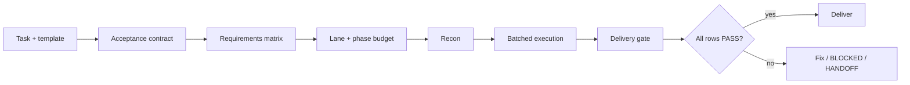

# Lean Run

Acceptance-first execution for coding agents. On a three-phase report task, it cut wall time by 48% while both arms passed acceptance on the first try.

**English** | [简体中文](README.zh-CN.md)


## Overview

Lean Run is a Markdown skill for OpenCode, Codex, Claude Code, and similar agents. It adds four controls to a task: an acceptance contract, a requirements matrix, per-phase budgets, and a delivery gate.

The target metric is time to accepted delivery.

## Problem

Agent tasks lose time in three places:

1. Repeated context reads on every turn.
2. Acceptance criteria discovered after the artifact is built.
3. Step caps reached with a partial deliverable.

Each one leads to rework. Rework costs more than a deliberate first pass.

## Workflow



1. **Acceptance contract.** Capture deliverables, template, figures, identity fields, external runs, and submission limits.
2. **Requirements matrix.** Each row has a source, evidence, and status. The task is complete when every row is PASS.
3. **Lane and phase budget.** L0 through L3; budgets are per phase; checkpoint at 80%.
4. **Template-first recon.** `template_spec.py` reads DOCX headings, placeholders, and image count.
5. **Batched execution.** Independent calls run together; expensive artifacts are cached.
6. **Delivery gate.** `delivery_check.py` checks ordered headings, figures, placeholders, values, and Unicode; a rendered-page review follows.
7. **Handoff.** Step caps produce `HANDOFF.md`; missing external dependencies produce `BLOCKED.md`.

## Latest A/B result

Task: three phases — normalized CSV + tests, five-sheet Excel workbook + chart, five-page PDF + three figures.
Method: same model and harness, two fresh subagents, acceptance criteria fixed before the run, independent judge.

| Metric | Control | Lean | Delta |
|---|---:|---:|---:|
| Wall time | 10.71 min | 5.53 min | **−5.18 min (−48%)** |
| Model turns | 49 | 25 | −24 (−49%) |
| Tool calls | 71 | 42 | −29 (−41%) |
| Reasoning tokens | 42,953 | 20,571 | −52% |
| Cache reads | 3,288,320 | 876,800 | −73% |
| Tests | 54 | 34 | both pass |
| First-pass acceptance | yes | yes | equal |

Both arms produced a five-sheet workbook, five-page PDF, and three figures; the same independent judge passed both. See [`benchmarks/2026-11-26-latest.md`](benchmarks/2026-11-26-latest.md).

Historical runs and the budget stress test are in [`benchmarks/2026-11-26.md`](benchmarks/2026-11-26.md) and [`benchmarks/2026-11-26-budget.md`](benchmarks/2026-11-26-budget.md).

## Features

| Area | Behavior |
|---|---|
| Acceptance | Contract + requirements matrix with evidence |
| Lanes | L0 answer, L1 single file, L2 multi-file, L3 irreversible/formal deliverable |
| Budgets | Per phase; 80% checkpoint; one split or extension with a written reason |
| Delivery | Template parser, PDF checker, rendered-page review |
| External runs | Missing hardware/account/license → BLOCKED; no local substitute |
| Measurement | Turns, step time, first-pass acceptance |

## Install

### OpenCode

```powershell
python -m pip install -r requirements.txt
Copy-Item -Recurse -Force .\skills\lean-run "$HOME\.config\opencode\skills\lean-run"
Copy-Item -Force .\commands\lean.md "$HOME\.config\opencode\commands\lean.md"
# Merge AGENTS.example.md into $HOME\.config\opencode\AGENTS.md
```

Open a new session. `/lean <task>` forces the skill.

If the destination directory exists, `Copy-Item -Recurse` can create `lean-run\lean-run`; copy the contents or remove the old directory first.

### Codex / Claude Code

Copy `skills/lean-run` into the agent's skills directory and merge `AGENTS.example.md` into its instruction file. `measure.py` reads OpenCode's SQLite database.

## Quickstart

```text
/lean Build a three-phase order report: normalized CSV, Excel workbook with a chart, and a five-page PDF.
```

The agent starts with:

```text
Lane: L2
ACCEPT: 22 rows
DONE: 0/22 PASS
Phase 1  normalize + tests     budget 8
Phase 2  Excel + chart         budget 8
Phase 3  PDF + 3 figures       budget 8
```

It then works through the phases and returns the matrix with evidence.

## Budget model

A phase that exceeds its budget has three allowed outcomes:

1. Split into a smaller phase with its own matrix subset.
2. Extend once with a written reason and a new budget.
3. Hand off with `HANDOFF.md` when the harness step cap is reached.

Silent grinding and partial delivery are rejected. Missing external dependencies produce `BLOCKED.md`.

Count model turns from the harness or session stats. When no counter is available, use tool calls and wall time as an `estimated` proxy with a 1.5× margin.

## Repository layout

```text
.
├── AGENTS.example.md
├── commands/lean.md
├── skills/lean-run/
│   ├── SKILL.md
│   ├── measure.py
│   ├── delivery_check.py
│   └── template_spec.py
├── benchmarks/
│   ├── 2026-11-26.md
│   ├── 2026-11-26-budget.md
│   └── 2026-11-26-latest.md
├── requirements.txt
├── README.md
└── README.zh-CN.md
```

## Limitations

- `delivery_check.py` handles PDFs. DOCX/PPTX need a PDF conversion or a manual review.
- Image counting covers raster images. Vector figures need a caption text check or a visual review.
- First-pass acceptance is logged manually. The transcript does not encode it reliably.
- `measure.py` targets OpenCode's SQLite schema.
- Benchmarks cover one model, one machine, and a small sample.

## Roadmap

- Native DOCX/PPTX delivery checks.
- Automatic first-pass and rework inference from transcripts.
- Template font and page-size comparison.
- More models and harnesses.

## Contributing

Open an issue or pull request. Run `python -m py_compile` on the scripts and the delivery checker before submitting. Keep the skill small.

## License

MIT
