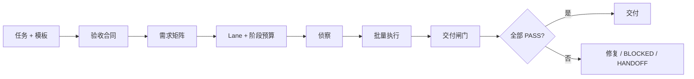

# Lean Run

面向编码 Agent 的验收优先执行技能。在一个三阶段报告任务上，墙钟时间缩短 48%，两边首次验收均通过。

[English](README.md) | **简体中文**


## 概述

Lean Run 是一个 Markdown 技能，适用于 OpenCode、Codex、Claude Code 等 Agent。它给任务增加四个控制点：验收合同、需求矩阵、阶段预算、交付闸门。

目标指标：从开始到验收通过的时间。

## 问题

Agent 任务的时间主要损耗在三处：

1. 每个回合重复读取上下文。
2. 产物完成后才发现验收要求。
3. 步数上限到达时只交付了半成品。

这些情况都会产生返工。返工成本高于一次有准备的交付。

## 工作流



1. **验收合同。** 收集交付物、模板、图表、身份字段、外部运行、提交限制。
2. **需求矩阵。** 每行包含来源、证据、状态；全部 PASS 才算完成。
3. **Lane 与阶段预算。** L0 到 L3；预算按阶段计算；80% checkpoint。
4. **模板优先侦察。** `template_spec.py` 读取 DOCX 标题、占位符、图片数量。
5. **批量执行。** 独立调用并行；昂贵产物缓存。
6. **交付闸门。** `delivery_check.py` 检查标题顺序、图、占位符、数值、Unicode；随后做渲染目检。
7. **交接。** 步数上限写 `HANDOFF.md`；外部依赖缺失写 `BLOCKED.md`。

## 最新 A/B 结果

任务：三阶段——归一化 CSV + 测试、五 sheet Excel + 图表、五页 PDF + 三张图。
方法：同模型、同 harness、两个全新子 agent、验收标准在运行前固定、独立 judge。

| 指标 | control | lean | 变化 |
|---|---:|---:|---:|
| 墙钟 | 10.71 min | 5.53 min | **−5.18 min（−48%）** |
| 模型回合 | 49 | 25 | −24（−49%） |
| 工具调用 | 71 | 42 | −29（−41%） |
| 推理 token | 42,953 | 20,571 | −52% |
| 缓存重读 | 3,288,320 | 876,800 | −73% |
| 测试 | 54 | 34 | 两边通过 |
| 首次验收 | 是 | 是 | 一致 |

两边都生成了五 sheet workbook、五页 PDF、三张图；同一套独立 judge 均通过。详见 [`benchmarks/2026-11-26-latest.md`](benchmarks/2026-11-26-latest.md)。

历史轮次和预算压力测试见 [`benchmarks/2026-11-26.md`](benchmarks/2026-11-26.md) 与 [`benchmarks/2026-11-26-budget.md`](benchmarks/2026-11-26-budget.md)。

## 功能

| 领域 | 行为 |
|---|---|
| 验收 | 验收合同 + 带证据的需求矩阵 |
| Lane | L0 问答、L1 单文件、L2 多文件、L3 不可逆/正式交付 |
| 预算 | 按阶段；80% checkpoint；一次拆分或延长，需写明理由 |
| 交付 | 模板解析、PDF 检查、渲染目检 |
| 外部运行 | 硬件/账号/License 缺失 → BLOCKED；禁止本地替代 |
| 测量 | 回合、步进时间、首次验收率 |

## 安装

### OpenCode

```powershell
python -m pip install -r requirements.txt
Copy-Item -Recurse -Force .\skills\lean-run "$HOME\.config\opencode\skills\lean-run"
Copy-Item -Force .\commands\lean.md "$HOME\.config\opencode\commands\lean.md"
# 把 AGENTS.example.md 合并进 $HOME\.config\opencode\AGENTS.md
```

新开一个会话。`/lean <任务>` 强制启用该技能。

如果目标目录已经存在，`Copy-Item -Recurse` 可能产生 `lean-run\lean-run`；请复制目录内容，或先删除旧目录。

### Codex / Claude Code

把 `skills/lean-run` 复制到对应 Agent 的技能目录，并把 `AGENTS.example.md` 合并进它的指令文件。`measure.py` 读取 OpenCode 的 SQLite 数据库。

## 快速开始

```text
/lean 生成一个三阶段订单报告：归一化 CSV、带图表的 Excel、五页 PDF。
```

Agent 会先输出：

```text
Lane: L2
ACCEPT: 22 行
DONE: 0/22 PASS
Phase 1  normalize + tests     budget 8
Phase 2  Excel + chart         budget 8
Phase 3  PDF + 3 figures       budget 8
```

随后按阶段执行，并返回带证据的需求矩阵。

## 预算模型

阶段超出预算时，允许三种处理：

1. 拆分成更小的阶段，各自持有需求矩阵的子集。
2. 一次性延长，写明剩余工作、无法拆分的原因、新预算。
3. harness 步数上限到达时写 `HANDOFF.md` 交接。

静默硬磨和半成品交付会被判失败。外部依赖缺失时写 `BLOCKED.md`。

回合数从 harness 或 session 统计中读取。没有计数器时，用工具调用和墙钟时间作为 `estimated` 代理，并乘以 1.5 的安全系数。

## 仓库结构

```text
.
├── AGENTS.example.md
├── commands/lean.md
├── skills/lean-run/
│   ├── SKILL.md
│   ├── measure.py
│   ├── delivery_check.py
│   └── template_spec.py
├── benchmarks/
│   ├── 2026-11-26.md
│   ├── 2026-11-26-budget.md
│   └── 2026-11-26-latest.md
├── requirements.txt
├── README.md
└── README.zh-CN.md
```

## 限制

- `delivery_check.py` 处理 PDF。DOCX/PPTX 需要先转 PDF，或人工检查。
- 图片计数覆盖位图。矢量图需要图注文本检查，或渲染目检。
- 首次验收率目前人工记录。会话记录无法可靠编码该结果。
- `measure.py` 面向 OpenCode 的 SQLite schema。
- 基准覆盖单模型、单机、小样本。

## 路线图

- DOCX/PPTX 原生交付检查。
- 从会话记录自动推断首次验收与返工。
- 模板字体与页尺寸比对。
- 更多模型与 harness。

## 贡献

欢迎提交 issue 或 pull request。提交前运行 `python -m py_compile` 检查脚本，并跑一遍 delivery checker。保持技能精简。

## License

MIT
